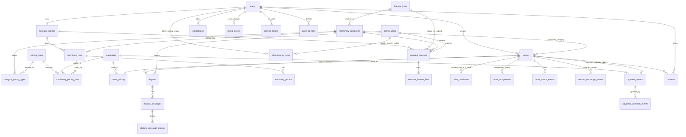

# Доменная модель и ERD (MVP)

## 1) Цель

Минимальная модель MVP: без обязательной безопасной сделки, без внутреннего кошелька, без жёсткого календаря занятости (только окна заказа + мягкое предупреждение). Выровнена с `USER_SCENARIOS.md`.

## 2) Сущности

### `users`

- `id`, `phone` (unique, логин), `full_name`;
- `current_mode` (`client` | `executor`) — единственное поле роли; задаётся при регистрации, меняется переключением;
- `contact_phone` (nullable);
- `telegram_url`, `whatsapp_url`, `max_url` (nullable);
- `messengers_json` (доп. пары `{ name, url }`);
- `rating_as_client`, `rating_as_executor` (внутренние, в UI нет);
- `blocked_at`, `blocked_reason` (nullable, бан админом);
- `created_at`, `updated_at`.

Нет `default_mode`, `is_client_enabled`, `is_executor_enabled`.

Для создания и принятия заказа: непустой `full_name` и хотя бы один канал из `contact_phone` / `telegram_url` / `whatsapp_url` / `max_url` / непустого `messengers_json`.

### `executor_profiles`

- `user_id` unique, `avatar_url`, `about`;
- `accepts_urgent_orders` (bool) — чекбокс «принимаю срочные заказы» на экране профиля; меняет только сам исполнитель;
- `subscription_status` (`none`, `active`, `paused`, `expired`);
- `subscription_expires_at` (nullable);
- `payout_card_token` (nullable) — синоним карты для выплат от ЮKassa (саму карту не храним);
- `payout_card_mask` (nullable) — маска для UI (`•••• 1234`);
- `payout_card_added_at` (nullable);
- `created_at`, `updated_at`.

Без `payout_card_token` нельзя «подтвердить условия» по заказу с `secure_deal`. Удалить карту нельзя, пока по заказу исполнителя со сделкой платёж `authorized` (ждёт выплаты); заменить можно.

Создаётся при регистрации в режиме исполнителя или при первом переключении на исполнителя.

`accepts_urgent_orders = false` скрывает исполнителя только из выдачи по срочным заказам; по плановым он виден. Система этот флаг не переключает.

Пока `executor_subscription_enabled = false`, статус подписки не ограничивает поиск.

### `license_types`

Справочник типов лицензии. Ведёт админ в админке.

- `id`;
- `code` unique — системное обозначение (например `B`, `C`, `CE`);
- `name_ru` — текст для интерфейса;
- `is_active`;
- `created_at`, `updated_at`.

### `machinery_categories`

Строка таблицы **и есть** конфиг типа транспорта. Отдельного JSON `license_config` нет. Создаёт и правит админ; сида стартовых типов нет.

- `id`;
- `code` unique — внутреннее системное обозначение типа транспорта;
- `name_ru` — текст для интерфейса;
- `license_type_id` — обязательная ссылка на `license_types`; без типа лицензии категорию не сохранить;
- `is_active`;
- `created_at`, `updated_at`.

Селект при создании машины — активные строки этой таблицы.

Смена `license_type_id` у категории: все лицензии исполнителей по этой категории (`approved` / `pending` / `rejected`) требуют новой подачи; машины категории выпадают из поиска, пока исполнитель не подаст документы заново и админ не одобрит.

### `pricing_types`

- `code` PK (`hour`, `shift`, `day`, `month`, `trip`, `km`);
- `name_ru`.

### `category_pricing_types`

- `category_id`, `pricing_type_code` — PK;
  какие тарифы разрешены типу. Источник истины для UI и API, не хардкод клиента.

### `machinery_units`

- `id`, `executor_profile_id`, `category_id`;
- `address_text`, `location_lat`, `location_lng`;
- `deleted_at` (nullable, мягкое удаление);
- `created_at`, `updated_at`.

Лимита единиц нет. Флага занятости на единице нет.

### `machinery_photos`

- `id`, `machinery_unit_id`, `url`, `sort_order`;
- `created_at`.

Файлы загружает исполнитель, в API с клиента URL не принимаются. У активной единицы минимум одно фото; последнее удалить нельзя. Аватар исполнителя — тоже файлом. Запись в объектное хранилище — через порт `ObjectStorage` (не прямой S3 SDK); детали — `TECH_STACK.md` § «Файлы», `BACKEND_STRUCTURE.md`.

### `currencies`

Справочник валют для тарифов, заказов и `secure_deal`. Провайдер оплаты/выплат выбирается по валюте.

- `code` PK — ISO 4217 (`RUB`, …);
- `minor_units` — число знаков после запятой (для `RUB` = 2);
- `is_active`;
- `secure_deal_provider_code` (nullable) — код адаптера `PaymentProvider` для безопасной сделки (`yookassa` для `RUB`); `null` = `secure_deal` в этой валюте недоступен;
- `created_at`, `updated_at`.

В MVP сидируется одна строка: `RUB` → `yookassa`. Новая страна/валюта = новая строка + адаптер провайдера, который умеет карты этой зоны.

### `machinery_pricing_rules`

- `id`, `machinery_unit_id`, `pricing_type`, `base_rate` (> 0), `currency` → `currencies.code`;
- `is_active`;
- unique активных `(machinery_unit_id, pricing_type)`.

`currency` должна быть `is_active`. В MVP UI и API принимают только `RUB`. Тариф принадлежит единице.

В поиске единица участвует только если: не удалена, подписка ок (если флаг), есть нужный тариф, лицензия категории `approved`, и для срочного поиска — `accepts_urgent_orders`.

### `executor_licenses`

Одна лицензия на пару исполнитель + категория (не на каждую машину). Лицензия нужна для каждого типа транспорта. Верифицирует **админ** (`SERVICE_RULES.md`).

- `id`;
- `executor_profile_id`;
- `category_id`;
- `license_type_id` (копия с категории на момент подачи; при смене типа лицензии у категории лицензия перестаёт считаться действительной);
- `status` (`pending`, `approved`, `rejected`);
- `reject_comment` (nullable);
- `reviewed_by_admin` (nullable);
- `created_at`, `updated_at`.

Срока действия / `expires_at` **нет**.

Уникально `(executor_profile_id, category_id)`. Документы — `executor_license_files`:

- `license_id`, `url`, `created_at`;
- `doc_kind`: `driver_license` (права) | `equipment_usage_right` (право пользования техникой — любой подходящий документ).

Для подачи на проверку нужны файлы обоих видов. Машину без `approved` сохранить можно, в поиске нет. Отзыв `approved` / блокировка пользователя — незавершённые заказы исполнителя → `published` + возврат холда (`SERVICE_RULES.md`).

### `orders`

- `status`: `draft`, `published`, `in_negotiation`, `awaiting_payment`, `scheduled`, `in_progress`, `completed`, `disputed`, `cancelled`;
- `client_user_id`, `category_id`, `settlement_mode` (`direct_payment` | `secure_deal`);
- `search_mode` (`urgent` | `planned`);
- `planned_start_at` (timestamptz, nullable; обязательно при `planned`, пусто при `urgent`) — начало окна работ; системно: автоотмена «исполнитель не найден» на `published`, перевод `scheduled` → `in_progress`, граница окна отмены на `scheduled`;
- `planned_end_at` (timestamptz, nullable) — **до какого момента** заказ должен быть завершён (задаёт заказчик). Обязателен при `planned` и строго позже `planned_start_at`. При `urgent` — опционально («нужно к …»). Окна занятости / предупреждения / фильтр поиска — `SEARCH_ALGORITHM.md` §6;
- `search_activity_at` (nullable) — последняя активность в поиске: вход в `published`, отправка запроса исполнителю, правка заказа клиентом. Точка отсчёта 24 часов бездействия для автоотмены срочного;
- `details_version` (int, default 1);
- `address_text`, `location_lat`, `location_lng`, `description` (nullable);
- `terms_confirm_deadline_at` (nullable; вход в `in_negotiation` + 1 сутки, сброс при правке деталей);
- `payment_deadline_at` (nullable; «подтвердить условия» + 1 сутки при `secure_deal`);
- `execution_confirmed_by_client_at`, `execution_confirmed_by_executor_at`;
- `execution_confirm_deadline_at` (nullable) — внутренний таймер автоприёмки: время первого из двух подтверждений «работа выполнена» + 1 сутки;
- `cancel_*`, `cancelled_by_user_id`, `cancelled_by_role` (`client` | `executor` | `system` | `admin`);
- `repeated_from_order_id`;
- `created_at`, `updated_at`.

Нет статуса `assigned`. Окно работ — `planned_start_at` / `planned_end_at` (см. выше); жёсткого запрета пересечений нет.

### `order_pricing`

Один к заказу. Сумму считает сервер.

- `pricing_type`, `quantity` (> 0), `unit_rate`, `computed_amount` (`unit_rate × quantity`), `currency` → `currencies.code` (копия с тарифа машины на момент фиксации);
- `deal_fee_amount` — комиссия провайдера за безопасную сделку, которую платит клиент (`0` при `direct_payment`); считает сервер по проценту из конфига, с округлением вверх до минорной единицы валюты (`currencies.minor_units`; для `RUB` — до копейки);
- `amount_to_pay` (`computed_amount + deal_fee_amount`) — сколько платит клиент по сделке; исполнителю выплачивается `computed_amount`;
- `priced_at` — момент фиксации.

`secure_deal` допустим, только если у `currency` задан `secure_deal_provider_code`.

`unit_rate` копируется с машины при **отправке запроса** (снимок). Правка `quantity` пересчитывает только `computed_amount` от этого снимка. Смена `pricing_type` — новый снимок ставки с машины для нового типа. Смена ставок исполнителем на машине уже созданный `order_pricing` не меняет. См. `PRODUCT_FOUNDATION.md` «Цена заказа».

### `order_candidates`

- `id`, `order_id`, `executor_user_id`, `machinery_unit_id`;
- `candidate_status`: `notified`, `accepted`, `declined`, `auto_declined`, `expired`, `withdrawn`, `negotiation_rejected`, `terms_expired`;
- `notified_at`, `response_deadline_at` (`notified_at` + 5 минут);
- `accepted_at` (nullable);
- `reject_reason_code`, `reject_reason_text` (nullable);
- `created_at`, `updated_at`.

Статуса `viewed` нет. `auto_declined` — система закрыла запрос, потому что исполнитель принял другой срочный заказ; для клиента это отказ, штрафа исполнителю нет.

**Одна строка на пару** `(order_id, executor_user_id)` (unique в БД). Повторный запрос после `withdrawn` — **UPDATE** той же строки снова в `notified` (новые `notified_at` / дедлайн), не INSERT. После `declined` / `auto_declined` / `expired` / `negotiation_rejected` / `terms_expired` повтор запрещён — код не переводит строку обратно в `notified`.

На заказ не более одного `notified` (partial unique). Один исполнитель может одновременно быть `notified` по нескольким заказам. Assignment при «подтвердить условия»; при возврате на поиск **не удаляется** — помечается снятым. Согласованность статусов — `ORDER_CONSISTENCY.md`.

### `order_assignments`

История закреплений исполнителя за заказом (0..N строк).

- `id`, `order_id`, `executor_user_id`, `machinery_unit_id`;
- `released_at` (nullable) — `null` = активное назначение;
- `release_reason` (nullable) — кратко: `unpaid_timeout` | `partner_rejected` | `terms_expired` | `client_edit` | `planned_cancel` | `consistency_repair` | …;
- `created_at`.

Появляется при «подтвердить условия». Возврат в `published` / отмена до работы после назначения → `released_at`, строка остаётся. Новое подтверждение условий после нового матча — **новая** строка. На заказ не больше одного активного (`released_at IS NULL`).

### `order_status_events`

- `id`, `order_id`, `from_status`, `to_status`, `event_type`, `actor_user_id` (nullable), `payload_json`, `created_at`.

### `contact_exchange_events`

- `id`, `order_id`, `created_at` — фиксация, что контакты открыты (первое «принять»).

### `disputes`

На заказ — **0..N** споров (история претензий не затирается). Одновременно не больше **одного** `open`.

- `id`, `order_id` (FK, не unique);
- `opened_by_user_id` (nullable, если открыл провайдер);
- `reason_code`, `reason_text`;
- `status` (`open`, `closed`);
- `appeal_used` (bool);
- `closed_to_status`, `closed_by_admin`;
- `created_at`, `updated_at`.

Апелляция: **та же** строка снова `open`, `appeal_used = true`, сообщения продолжаются; не больше одной апелляции **на этот** спор. Новая независимая претензия после закрытия — **новая** строка `disputes` (если ещё можно открыть спор по правилам заказа). Обращения в поддержку не по заказу (баг приложения и т.п.) в MVP **не** моделируем.

### `dispute_messages` / `dispute_message_photos`

Сообщения спора (`author_kind`: client | executor | admin) и фото к сообщению.

### `reviews`

После `completed`, по одному отзыву каждой стороны.

- `order_id`, `from_user_id`, `to_user_id`, `author_role` (`client` | `executor`);
- `stars` (1–5), `body` (nullable);
- unique `(order_id, from_user_id)`.

Отзывы об исполнителе видны в поиске и профиле. Отзывы о клиенте — исполнителю в карточке входящего запроса как средняя оценка и число отзывов (без текста и контактов).

### `notifications`

- `id`, `user_id`, `type`, `payload_json`, `read_at` (nullable), `created_at`.

Прочтение не меняет статус кандидата.

### `rating_events`

Правила — `RATING_PLAN.md`.

- `id`, `user_id`, `role` (`client` | `executor`), `event_type`, `delta`, `order_id` (nullable);
- `status` (`applied` | `pending_admin`), `resolved_by_admin`, `resolved_at` (nullable) — для причины `other`;
- `created_at`.

### `payment_records` / `payment_webhook_events`

На заказ — **0..N** попыток оплаты (`secure_deal`). История сохраняется; одновременно живой холд/ожидание оплаты — не больше одной попытки.

- `payment_records`:
  - `id`, `order_id` (FK, **не** unique);
  - `currency`, `provider_code` (из `currencies.secure_deal_provider_code` на момент создания);
  - `provider_deal_id` (nullable до ответа провайдера), `provider_payment_id` (nullable), `provider_payout_id` (nullable);
  - `payment_status` (`pending` | `authorized` | `captured` | `failed` | `cancelled` | `refunded`; для `direct_payment` записей нет — на заказе логический `not_required`);
  - `idempotency_key` — ключ `create-payment`, пишется **до** вызова провайдера; unique;
  - сумма платежа = `amount_to_pay`, сумма выплаты = `computed_amount`;
  - `created_at`, `updated_at`.
- `payment_webhook_events`: `id`, `payment_record_id` (FK, nullable если событие ещё не сопоставлено), `provider_event_id` unique, сырое тело, `processed_at` (nullable), `created_at`.

Холд только после успешной оплаты на `awaiting_payment`. Клиент сумму не задаёт. В MVP провайдер — ЮKassa (`RUB`): `authorized` = деньги на балансе сделки, `captured` = выплата исполнителю прошла (`ORDER_STATE_MACHINE.md`, раздел 5). Попытки, `failed`, late webhook и reconcile — там же §5.1–5.4. При появлении других валют — тот же поток через другой адаптер `PaymentProvider`.

### `idempotency_keys`

Хранение клиентских `Idempotency-Key` для money-мутаций, кроме ключа `create-payment` (он на `payment_records.idempotency_key`): cancel / reject на `awaiting_payment`, confirm-execution, admin payout/refund/cancel с холдом (`API_CONTRACT_MVP.md` §8.0).

- `id`, `user_id` или `admin_user_id` (кто вызвал), `key` , `route` (стабильный путь операции), `request_hash` (хэш тела);
- `response_code`, `response_body` (для replay);
- `created_at`, `expires_at`.

Unique `(actor_type, actor_id, route, key)`.

### `admin_users`

Админы — отдельные учётные записи, не пользователи приложения.

- `id`, `email` unique, `password_hash`;
- `totp_secret` — второй фактор (приложение-аутентификатор);
- `is_active`, `last_login_at` (nullable);
- `created_at`, `updated_at`.

`reviewed_by_admin`, `closed_by_admin`, `resolved_by_admin` и автор `admin` в `dispute_messages` ссылаются на `admin_users.id`.

### `auth_codes`

Коды входа по телефону.

- `id`, `phone`, `code_hash`, `channel` (`telegram` | `sms`);
- `attempts` (неверные вводы), `expires_at`, `used_at` (nullable);
- `created_at`.

Лимиты частоты запросов кода считаются по этой таблице (на номер) и по IP.

Перед `request-code` (и уже при вводе номера) API отвечает, **есть ли OTP-провайдер под этот номер** — по конфигу адаптеров (Telegram Gateway / SMS и их правила покрытия), не по IP и не по хардкоду «списка стран» в приложении. Нет провайдера → регистрация/вход с этим номером недоступны.

### `refresh_tokens`

- `id`, `user_id`, `token_hash` unique, `expires_at`, `revoked_at` (nullable);
- `created_at`.

При блокировке пользователя все его refresh-токены отзываются.

### `push_devices`

- `id`, `user_id`, `expo_push_token` unique, `platform` (`ios` | `android`);
- `last_seen_at`, `created_at`.

Один пользователь — несколько устройств. Токен, который Expo вернул как недействительный, удаляется.

### `subscription_payments` (когда флаг подписки включён)

Платёж активации исполнителя, не холд заказа. Webhook → `subscription_status = active`.

## 3) ERD

## 4) Инварианты

- Один аккаунт — клиент и исполнитель; UI от `current_mode`.
- Неограниченный парк; тарифы на единице; набор тарифов задаёт тип транспорта.
- Контакты скрыты до первого accept; минимум имя + один канал.
- У типа транспорта обязателен тип лицензии из справочника админа. Лицензия одна на категорию; без `approved` машины категории не в поиске. Смена типа лицензии у категории сбрасывает действительность лицензий и убирает машины из поиска.
- Свою технику заказать нельзя. Заблокированный не ищет и не принимает.
- Цена заказа = ставка × количество, не ручной ввод.
- Жёсткого календаря нет: занятость — мягко по окнам заказа (`SEARCH_ALGORITHM.md` §6). У `planned` обязательны начало и конец; у `urgent` конец опционален. Окно влияет на выдачу (скрытие занятых) и предупреждение при accept/confirm-terms; запрета принять нет.
- Срочный поиск показывает только `accepts_urgent_orders = true`; флаг меняет только исполнитель.
- На один заказ один ожидающий кандидат; одна строка кандидата на пару заказ×исполнитель; у одного исполнителя может быть несколько ожидающих запросов. Принял срочный — остальные срочные `auto_declined` (на уровне исполнителя, не машины).
- Пока заказ не в `scheduled` / `in_progress`, срыв матча возвращает заказ в поиск. После фиксации сделки поиск на этом заказе нельзя.
- Полную отмену до фиксации сделки делает только клиент; исполнитель до этого только отклоняет партнёра. Плановый на `scheduled` могут отменить обе стороны. На `in_progress` пользователи только через спор.
- `published` без кандидата протухает: срочный — 24 ч без активности клиента, плановый — дата начала.
- Не ответил за 5 минут = отказ (скрыт, повторно нельзя).
- Открытый спор отменяет таймер автоприёмки.
- Споров на заказ 0..N; одновременно не больше одного `open`. Спор — с `in_progress` / `completed` (не с `scheduled`).
- Деньги: источник истины — провайдер, выбранный по `currency`. Нет платежа — нет возврата холда провайдером. После `captured` админ деньги не двигает. Вход по телефону — только если есть OTP-провайдер под номер (`phone-support`).
- `secure_deal`: на заказ 0..N `payment_records`; одновременно не больше одной записи в `pending` или `authorized`. После `failed` — новый row на следующую попытку. `create-payment` пишет `pending` + `idempotency_key` до вызова провайдера.
- Назначения: 0..N `order_assignments`, не больше одного с `released_at IS NULL`. Полная матрица со статусом заказа / кандидатом / оплатой — `ORDER_CONSISTENCY.md`.

## 5) Жёсткие ограничения БД

Источник переходов — `ORDER_STATE_MACHINE.md`. Матрица «заказ ↔ кандидат ↔ назначение ↔ платёж» — `ORDER_CONSISTENCY.md`. Здесь — что **обязано** жить в PostgreSQL (unique / partial unique / CHECK / FK), чтобы гонка или баг не записали ерунду. Остальное — код + sweeper.

Prisma/миграции должны отразить этот список один в один.

### 5.1) Unique и partial unique (обязательно)

| Ограничение                                                                                          | Зачем                                                  |
| ---------------------------------------------------------------------------------------------------- | ------------------------------------------------------ |
| `users.phone` unique                                                                                 | логин                                                  |
| `currencies.code` PK; сид MVP: `RUB` → `yookassa`                                                    | валюта / провайдер                                     |
| `executor_profiles.user_id` unique                                                                   | один профиль исполнителя                               |
| `license_types.code` unique                                                                          | справочник                                             |
| `machinery_categories.code` unique                                                                   | справочник                                             |
| `category_pricing_types(category_id, pricing_type_code)` PK                                          | тарифы категории                                       |
| `machinery_pricing_rules`: partial unique `(machinery_unit_id, pricing_type) WHERE is_active`        | одна активная ставка типа                              |
| `executor_licenses(executor_profile_id, category_id)` unique                                         | одна лицензия на категорию                             |
| `order_pricing.order_id` unique                                                                      | ровно одна цена на заказ                               |
| `order_candidates(order_id, executor_user_id)` unique                                                | одна строка на пару; повтор после `withdrawn` = UPDATE |
| `order_candidates`: partial unique `order_id WHERE candidate_status = 'notified'`                    | один ожидающий запрос на заказ                         |
| `order_assignments`: partial unique `order_id WHERE released_at IS NULL`                             | одно активное назначение                               |
| `disputes`: partial unique `order_id WHERE status = 'open'`                                          | один открытый спор                                     |
| `reviews(order_id, from_user_id)` unique                                                             | один отзыв от стороны                                  |
| `payment_records.idempotency_key` unique                                                             | replay `create-payment`                                |
| `payment_records`: partial unique `order_id WHERE payment_status IN ('pending', 'authorized')`       | одна живая попытка оплаты                              |
| `payment_records(provider_code, provider_payment_id)` unique WHERE `provider_payment_id IS NOT NULL` | id у провайдера                                        |
| `payment_webhook_events.provider_event_id` unique                                                    | идемпотентность webhook                                |
| `idempotency_keys(actor_type, actor_id, route, key)` unique                                          | money-replay кроме create-payment                      |
| `admin_users.email` unique                                                                           | вход админа                                            |
| `refresh_tokens.token_hash` unique                                                                   | сессии                                                 |
| `push_devices.expo_push_token` unique                                                                | устройство                                             |

Повторный запрос исполнителю после блокирующих статусов (`declined` / `auto_declined` / `expired` / `negotiation_rejected` / `terms_expired`) — **не** отдельный DB exclude: unique пары + код не делает UPDATE обратно в `notified`.

### 5.2) CHECK (обязательно, где дёшево)

- `orders`: `(search_mode = 'urgent' AND planned_start_at IS NULL) OR (search_mode = 'planned' AND planned_start_at IS NOT NULL AND planned_end_at IS NOT NULL AND planned_end_at > planned_start_at)`;
- `orders`: при `urgent` если `planned_end_at` задан — он в будущем на момент создания/публикации (проверка в коде; при правке — снова валидно);
- `orders.settlement_mode` ∈ (`direct_payment`, `secure_deal`); `orders.search_mode` ∈ (`urgent`, `planned`); `orders.status` ∈ известному enum FSM;
- `order_pricing.quantity > 0`; `unit_rate > 0`; `computed_amount >= 0`; `deal_fee_amount >= 0`; `amount_to_pay = computed_amount + deal_fee_amount` (или считать `amount_to_pay` generated/всегда писать в одной TX с проверкой в коде — если generated неудобен в Prisma, CHECK на `amount_to_pay >= computed_amount`);
- `machinery_pricing_rules.base_rate > 0`;
- `reviews.stars` BETWEEN 1 AND 5;
- `executor_license_files.doc_kind` ∈ (`driver_license`, `equipment_usage_right`);
- `payment_records.payment_status` ∈ (`pending`, `authorized`, `captured`, `failed`, `cancelled`, `refunded`);
- `order_candidates.candidate_status` ∈ полном enum выше;
- `disputes.status` ∈ (`open`, `closed`).

`machinery_categories.license_type_id` — NOT NULL.

### 5.3) FK (обязательно)

Все перечисленные в ERD связи — обычные FK. Удаление пользователя / заказа в MVP **не** каскадим слепо: заказы и платежи сохраняем; soft-block пользователя. Фото/файлы лицензий — ON DELETE CASCADE с родительской лицензией ок. `order_pricing` — CASCADE с `orders` или запрет удаления заказа (предпочтительнее не удалять заказы).

### 5.4) Только в коде + sweeper (не CHECK на весь FSM)

Матрица статусов из `ORDER_CONSISTENCY.md` (например «на `in_progress` должно быть активное назначение») в БД **не** кодируем одним CHECK — слишком хрупко и мешает легитимным промежуточным TX. Держим: транзакции `FOR UPDATE` на `orders`, инварианты в сервисе, периодический sweeper/reconcile + алерты.

То же: «не заказать свою технику», «без `approved` не в поиске», окна спора 2 суток, автоотказ срочных — код/джобы.

### 5.5) Рекомендуемые индексы

- `orders(status)`, `orders(client_user_id, status)`, `orders(search_mode, status)`;
- `machinery_units(executor_profile_id)`, `machinery_units(location_lat, location_lng)`; на проде — PostGIS geography/GIST по точке машины (`TECH_STACK.md`);
- `executor_profiles(accepts_urgent_orders, subscription_status)`;
- `order_candidates(executor_user_id, candidate_status)` — автоотказ срочных;
- `order_candidates(response_deadline_at)`, `orders(terms_confirm_deadline_at)`, `orders(payment_deadline_at)`, `orders(execution_confirm_deadline_at)`;
- `orders(status, search_activity_at)`, `orders(status, planned_start_at)` — «не найден» и `scheduled`→`in_progress`;
- `rating_events(status)` — очередь `pending_admin`;
- `orders(cancel_reason_code)`, `orders(cancelled_by_role)`, `orders(repeated_from_order_id)`;
- `notifications(user_id, created_at)`;
- `reviews(to_user_id)`;
- `executor_licenses(status)` — очередь админки;
- `auth_codes(phone, created_at)`;
- `refresh_tokens(user_id)`, `push_devices(user_id)`;
- `payment_records(order_id, created_at)`, `payment_records(payment_status, updated_at)` — UI и регулярный reconcile;
- `order_assignments(order_id, created_at)`;
- `idempotency_keys(expires_at)`.

## 6) Отложить

Источник сроков/триггеров по деньгам и календарю — `PRODUCT_FOUNDATION.md` §17.

- **Жёсткий календарь** (запрет пересечений, буферы) — до боли на проде от мягких окон или явного решения ужесточить; сейчас только окна + warning (`SEARCH_ALGORITHM.md` §6).
- **Компенсация / взыскание после `captured`** — до юр. модели.
- **Частичный возврат / частичная выплата** — до спроса после стабильного полного money-path.
- Показ внутреннего рейтинга в UI — до отдельного продуктового решения (после запуска отзывов 1–5).
- `Company*` — до подтверждённой B2B-потребности.
