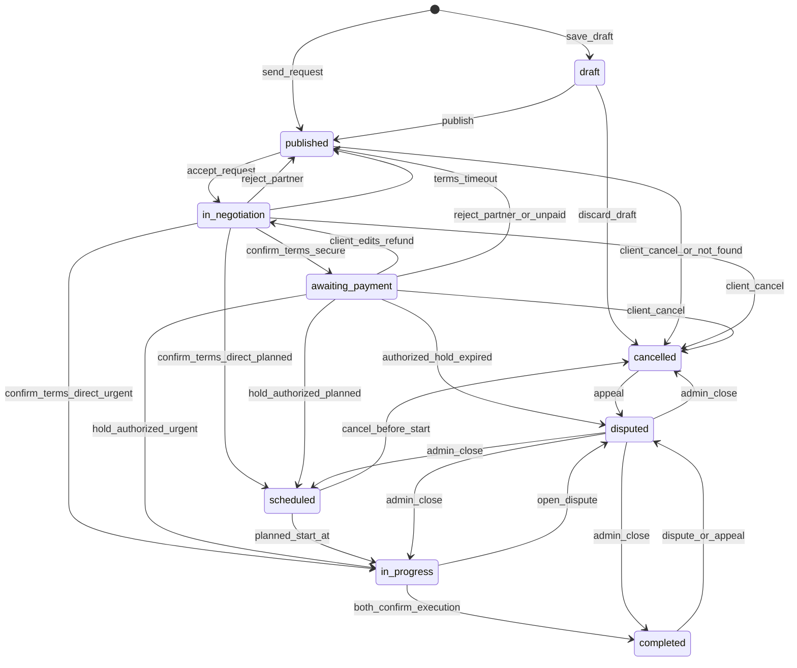

# Конечный автомат заказа и платежа (MVP)

## 1) Цель

Переходы статусов по `USER_SCENARIOS.md`. Согласованность заказа с кандидатом, назначением и платежом — `ORDER_CONSISTENCY.md`.

## 2) Состояния заказа

- `draft` — сохранён, запрос не отправлен, в поиске исполнителей не участвует.
- `published` — идёт поиск исполнителя: кандидата ещё нет, ждут первое «принять» или клиент выбирает следующего. Сюда же заказ **возвращается**, если матч сорвался **до** фиксации сделки (`scheduled` / `in_progress`).
- `in_negotiation` — запрос принят, контакты открыты. Заказчик правит детали, исполнитель жмёт «подтвердить условия» (срок **1 сутки**). Статуса `assigned` нет: сумму считает система.
- `awaiting_payment` — условия подтверждены, режим `secure_deal`, холд ещё не успешен. При `direct_payment` этого статуса нет.
- `scheduled` — **только плановый**: условия подтверждены (и при сделке — оплата прошла), ждём `planned_start_at`. Работа ещё не началась. У срочного этого статуса нет.
- `in_progress` — работа идёт фактически. Срочный — сразу после условий/оплаты. Плановый — автоматически с наступлением `planned_start_at` (из `scheduled`). Выход: обе стороны подтвердили исполнение или спор (отмена кнопкой на этом статусе нельзя).
- `completed` — обе подтвердили исполнение (или автоподтверждение молчащего). Отмены нет. Спор и отзывы доступны.
- `disputed` — есть хотя бы один спор со статусом `open` (на заказ может быть история из нескольких закрытых споров). Пользователи не отменяют. Закрывает админ.
- `cancelled` — полная отмена клиентом до работы, отказ от черновика, отмена планового на `scheduled`, системная отмена (исполнитель не найден), отмена админом, либо исход спора.

## 3) Возврат на поиск (пока сделка не зафиксирована)

Пока заказ не в `scheduled` и не в `in_progress`, срыв матча **не хоронит** заказ: тот же `orders`, статус `published`, клиент ищет другого. Полную отмену делает только клиент (или система / админ).

Возврат на поиск:

- отказ исполнителя на запросе;
- таймаут 5 минут (не ответил = отказ);
- автоотказ: исполнитель принял другой **срочный** заказ (раздел 6.1);
- клиент снял запрос (`withdrawn`);
- отклонение партнёра любой стороной на `in_negotiation` или `awaiting_payment`;
- исполнитель не подтвердил условия за 1 сутки;
- клиент не оплатил безопасную сделку за 1 сутки.

После `scheduled` или `in_progress` заказ в `published` не возвращается.

## 4) Допустимые переходы

- `draft -> published` — «опубликовать»: заказ в поиске **без кандидата**; запрос конкретной машине — отдельным действием
- `draft -> cancelled` — отказ от черновика
- `published -> in_negotiation` — «принять запрос» до 5 минут
- `published -> cancelled` — отмена клиентом без причины; **системная отмена** «исполнитель не найден» (раздел 4.2); отмена админом. Ожидающий кандидат, если есть, закрывается как `withdrawn`, исполнителю уведомление
- `in_negotiation -> in_negotiation` — заказчик сохранил правку (`details_version++`, сумма по правилам снимка ставки — `PRODUCT_FOUNDATION.md` «Цена заказа», сброс подтверждения, дедлайн подтверждения условий заново +1 сутки)
- `in_negotiation -> published` — отклонение партнёра (любая сторона), таймаут подтверждения условий
- `in_negotiation -> cancelled` — отмена **клиентом** с причиной; отмена админом
- `in_negotiation -> awaiting_payment` — «подтвердить условия», `secure_deal`
- `in_negotiation -> in_progress` — «подтвердить условия», `direct_payment`, **срочный**
- `in_negotiation -> scheduled` — «подтвердить условия», `direct_payment`, **плановый**
- `awaiting_payment -> in_negotiation` — заказчик изменил детали: отменить/вернуть холд или незавершённый платёж, версия++, исполнителю снова подтверждать
- `awaiting_payment -> published` — отклонение партнёра (любая сторона; платёж отменить/вернуть); таймаут 1 сутки без оплаты (платёж отменить, клиенту −3)
- `awaiting_payment -> in_progress` — холд `authorized`, **срочный**
- `awaiting_payment -> scheduled` — холд `authorized`, **плановый**
- `awaiting_payment -> cancelled` — отмена **клиентом** с причиной (платёж/холд отменить/вернуть); отмена админом
- `awaiting_payment -> disputed` — **только если** платёж уже `authorized` и истёк срок сделки у провайдера (деньги вернулись клиенту) (на практике после `authorized` заказ уже `scheduled` / `in_progress`; этот переход — защита, если статус платежа и заказа разошлись)
- `scheduled -> in_progress` — наступил `planned_start_at` (джоба, без кнопки)
- `scheduled -> cancelled` — отмена **любой стороной** с причиной до начала; отмена админом; холд при сделке возвращается
- `in_progress -> completed` — оба подтвердили исполнение (или автоподтверждение через 1 сутки после первого)
- `in_progress -> disputed` — спор (в т.ч. если исполнитель не вышел — решает клиент)
- `in_progress -> cancelled` — только отмена админом (пользователи — через спор)
- `completed -> disputed` — спор или апелляция
- `cancelled -> disputed` — только апелляция
- `disputed -> completed` | `cancelled` | `in_progress` | `scheduled` — только админка

Нельзя:

- спор из `draft` / `published` / `in_negotiation` / `awaiting_payment` / `scheduled`;
- полная отмена исполнителем на `in_negotiation` / `awaiting_payment` (у него только «отклонить партнёра»);
- отмена кнопкой из `in_progress`, `completed`, `disputed`;
- вернуть заказ в `published` из `scheduled` / `in_progress` и дальше — **кроме** админского пути: блокировка исполнителя или отзыв его лицензии (`SERVICE_RULES.md`: заказы → `published` + возврат холда);
- «подтвердить условия» с устаревшим `details_version` (`409 STALE_ORDER_DETAILS`).

Не меняют статус заказа (остаётся `published`):

- отказ или таймаут 5 минут на первом запросе → кандидат закрыт; исполнителю **−3** за таймаут;
- автоотказ (исполнитель принял другой срочный заказ) → кандидат закрыт, штрафа нет;
- клиент снял запрос до ответа → `withdrawn`;
- клиент правит фильтр заказа, пока нет ожидающего кандидата.

`409 INVALID_STATE_TRANSITION`
`409 ORDER_NO_LONGER_RELEVANT`
`409 CANCEL_NOT_ALLOWED`
`409 DISPUTE_NOT_ALLOWED`
`409 APPEAL_LIMIT_REACHED` / `409 APPEAL_NOT_ALLOWED`
`409 PAYOUT_CARD_REQUIRED`

### 4.1) Плановый заказ: `scheduled` и старт работ

После «подтвердить условия» / оплаты плановый заказ идёт в **`scheduled`**, не в `in_progress`:

- `direct_payment` → сразу `scheduled`;
- `secure_deal` → `awaiting_payment` → после холда `authorized` → `scheduled`.

Пока статус `scheduled` (до `planned_start_at`), обе стороны могут **отменить заказ с причиной** (стадия `planned_before_start`, `CANCELLATION_REASONS.md`) → `cancelled`, холд при сделке возвращается. Отменил исполнитель — клиенту уведомление с «искать снова?».

В момент `planned_start_at` джоба переводит `scheduled` → `in_progress` **без кнопки**. Спор на `scheduled` нельзя. Если исполнитель не вышел на объект после старта — клиент сам решает (в т.ч. открыть спор из `in_progress`).

У срочного статуса `scheduled` нет: после условий/оплаты сразу `in_progress`, окна отмены до «начала» нет.

### 4.2) Исполнитель не найден

Заказ в `published` без ожидающего кандидата автоматически отменяется системой:

- срочный — через **24 часа без активности клиента** по этому заказу: `search_activity_at` обновляется при входе в `published`, при каждой отправке запроса исполнителю и при правке заказа; отказ исполнителя таймер не сбрасывает, следующий запрос клиента — сбрасывает;
- плановый — при наступлении `planned_start_at`; если в этот момент есть кандидат `notified`, ждём его исход (≤ 5 минут), затем отменяем, если заказ всё ещё `published`.

`cancelled_by_role = system`, причины нет, штрафа нет, клиенту уведомление с «искать снова?».

## 5) Платёж (`secure_deal`)

- `not_required` — всегда для `direct_payment`.
- `pending` — платёж создан, клиент ещё не оплатил;
- `authorized` — клиент оплатил, деньги на балансе сделки у провайдера (это и есть «холд»);
- `captured` — деньги выплачены исполнителю;
- `failed`, `cancelled` — оплата не прошла / платёж отменён до оплаты;
- `refunded` — деньги со сделки возвращены клиенту.

Механизм — «Безопасная сделка» через `PaymentProvider` валюты заказа (`order_pricing.currency` → `currencies.secure_deal_provider_code`). В MVP это ЮKassa / `RUB`: оплата клиента сразу на баланс сделки, по завершении — выплата исполнителю на карту, при отмене — возврат клиенту. Подробнее — `TECH_STACK.md`, `PRODUCT_FOUNDATION.md` §6.

Режим расчёта клиент выбирает на экране отправки запроса. `secure_deal` при выключенном `secure_deal_enabled` → `409 SECURE_DEAL_DISABLED`.

Платёж создаётся **после** «подтвердить условия», на `awaiting_payment`, когда клиент открыл оплату. Сумма всегда `order_pricing.amount_to_pay` (`computed_amount` + комиссия сделки, её платит клиент), клиент сумму не передаёт. Исполнителю выплачивается `computed_amount`. Пока клиент не оплатил, у провайдера нет денег и **нечего возвращать**.

«Подтвердить условия» по заказу с `secure_deal` требует привязанной карты для выплат у исполнителя (`409 PAYOUT_CARD_REQUIRED`).

### 5.1) Попытки оплаты

На заказ допускается **несколько** записей `payment_records` (история попыток).

Инвариант: на один `order_id` одновременно не больше **одной** записи в статусе `pending` или `authorized`.

- Повтор `create-payment` с тем же `Idempotency-Key` при живом `pending` — вернуть тот же `payment_id` / `payment_url`, **не** создавать вторую сделку у провайдера.
- После `failed` запись остаётся `failed`; новая попытка оплаты — **всегда новый** `payment_records` row.
- `failed` **не** меняет статус заказа: заказ остаётся `awaiting_payment`, пока не сработает наш дедлайн оплаты или иное действие (отмена, отклонение партнёра, правка условий).

### 5.2) Дедлайн, отмены и правки на `awaiting_payment`

Истечение **наших** суток без оплаты → заказ **`published`** (поиск исполнителя), живой `pending` → `cancelled`, клиенту −3, без `disputed` и без `cancelled` заказа.

Правка деталей или отклонение партнёра на `awaiting_payment`: отменить `pending` / вернуть деньги со сделки, если уже оплачено (`authorized` → `refunded`).

Срок жизни сделки у провайдера — **180 дней** (максимум ЮKassa, задаётся один раз для магазина). Если к этому сроку не было ни выплаты, ни возврата, провайдер сам возвращает деньги клиенту → заказ `disputed`, ждём админа. Имеет смысл только при `authorized`.

### 5.3) Создание платежа и восстановление после сбоя

Порядок `create-payment`:

1. В одной транзакции создать (или найти по `Idempotency-Key`) attempt со статусом `pending` и сохранить ключ идемпотентности **до** вызова провайдера.
2. Вызвать провайдера (сделка → платёж).
3. Записать `provider_deal_id` / `provider_payment_id`.

Если процесс упал между шагами 1 и 3: фоновый reconcile опрашивает провайдера по metadata / idempotency ключу, дописывает ids либо помечает attempt `failed` без смены статуса заказа. Webhook и reconcile оба идемпотентны относительно текущего `payment_status` и `provider_event_id`.

**Регулярная сверка (cron).** Отдельно от crash-path: раз в **~10 минут** pg-boss job выбирает подозрительные `payment_records` и для каждой **перезапрашивает** объект у провайдера (как webhook), затем применяет **тот же** обработчик статусов (§5.3–5.4, выплата → `captured`, возврат → `refunded`, 180 дней → `disputed`).

Выборка MVP:

| Кандидат                                                                                             | Зачем                               |
| ---------------------------------------------------------------------------------------------------- | ----------------------------------- |
| `pending` старше **15 мин** (с ids или без)                                                          | потерянный webhook / обрыв create   |
| `authorized`, заказ уже `completed`, платёж ещё не `captured`                                        | зависшая выплата                    |
| `authorized` без смены статуса дольше **24 ч** (и заказ не в финале, где это нормально ждать работу) | зависший холд / молчание провайдера |
| `authorized`, до истечения срока сделки у провайдера **< 7 суток**                                   | заранее увидеть автовозврат ЮKassa  |

Правила:

1. Догнать статус можно **только** по известным переходам (как webhook). Неизвестное расхождение → **не** двигать деньги: алерт + запись в reconcile/audit лог (+ при необходимости заказ `disputed`).
2. Полный дневной diff всех сделок магазина с БД, сверка комиссий/НДС, автокомпенсации — **не MVP**.
3. Метрики: число mismatch, число «залипших» `pending` / `authorized` — `TECH_STACK.md`.

### 5.4) Поздний webhook `authorized`

Если провайдер сообщает успешную оплату (`authorized`), а заказ уже не ждёт оплату:

1. Заказ `awaiting_payment` — нормальный путь: платёж → `authorized`, заказ → `in_progress` (срочный) или `scheduled` (плановый).
2. Заказ `cancelled` или `published` — **автовозврат** клиенту, платёж → `refunded`; заказ **не** поднимаем.
3. Любой другой статус заказа (уже `scheduled` / `in_progress` / `completed` / `disputed` и т.п., «странное» расхождение) — деньги автоматически не двигать; эскалация: заказ → `disputed` (если ещё не там), алерт админу, запись в reconcile/audit лог.

### 5.5) Выплата и закрытие спора

Оба подтвердили `completed` (или автоподтверждение) — выплата (`captured`). После `captured` платформа **больше не двигает деньги** через провайдера: админ в споре может только санкции (рейтинг, блокировка), не возврат клиенту и не повторную выплату. В MVP **нет** и компенсации «из кармана» / вручную вне ЮKassa, и взыскания с исполнителя — только санкции при доказанной вине. В UI после выплаты **не обещать** возврат денег. Компенсация / взыскание — **отложено до юр. модели** (`PRODUCT_FOUNDATION.md` §17).

Спор после `completed`:

- открыть можно в течение **2 суток** с момента перехода в `completed` (`409 DISPUTE_WINDOW_EXPIRED` позже);
- выплата уже могла уйти (`captured`) — на возможность открыть спор это не влияет;
- с `in_progress` окно по суткам не режется (пока заказ в работе / до завершения).

`direct_payment`: платформа денег не держала и не возвращает. Спор и санкции — только если админ по доказательствам в треде признал нарушение; иначе закрытие без санкций / с разбором `other`.

Chargeback банка клиента после `captured` (MVP): внешнее событие → алерт мониторингу / очереди админа, заказ при необходимости в `disputed`, дальше ручной разбор. Автоматического возврата через нашу сделку нет (деньги уже у исполнителя).

Закрытие спора админом:

- холд ещё `authorized` (не `captured`) — админ может **целиком** выплатить или **целиком** вернуть;
- уже `captured` — денег не трогать, только статус заказа и санкции к пользователям при доказанной вине; закрытие в `cancelled` возврата **не** делает;
- платежа не было (`direct_payment` или не создавали) — денег нет; исход — статус + санкции по доказательствам.

**Отложено** (`PRODUCT_FOUNDATION.md` §17): частичный возврат холда, частичная выплата, пересчёт «только отработанные часы/рейсы» — до спроса после стабильного полного money-path. Неполный объём в MVP — через спор: полный возврат **или** полная выплата **или** (после `captured`) только санкции. Инициатива сторон — только спор (`in_progress` / `completed` в окне), без отдельного flow «зафиксировать факт».

Контракт API и обязательный `Idempotency-Key` на money-операциях — `API_CONTRACT_MVP.md` §8. Политика для пользователей — `SERVICE_RULES.md`.

## 6) Кандидаты, версии, повтор

На один заказ не более одного кандидата `notified`. Статуса `viewed` нет: открытие из уведомления ничего не меняет. Принял — принял, отказал — отказал, не ответил за 5 минут — это отказ.

Статусы кандидата: `notified`, `accepted`, `declined`, `auto_declined`, `expired`, `withdrawn`, `negotiation_rejected`, `terms_expired`.

Повтор тому же исполнителю на этот заказ:

- нельзя после `declined`, `auto_declined`, `expired`, `negotiation_rejected`, `terms_expired` (отказ, автоотказ, не ответил, не подтвердил — скрыт по заказу);
- можно после `withdrawn` (клиент сам снял).

Первый ответ: `response_deadline_at = notified_at + 5 минут`. Плановый заказ — тот же таймер.

Подтверждение условий: `terms_confirm_deadline_at = момент входа в in_negotiation + 1 сутки` (сбрасывается при правке деталей). После дедлайна ещё **30 секунд форы** на `confirm-terms` (раздел 7). Если и фора вышла — кандидат `terms_expired`, заказ `published`, исполнитель скрыт, исполнителю **−3**.

`details_version` начинается с 1 при переходе в `in_negotiation`. Правка заказчика: +1; `computed_amount` = сохранённый `unit_rate × quantity` (ставку с машины заново не берём, кроме смены `pricing_type` — тогда новый снимок ставки). Исполнителю уведомление. «Подтвердить условия» передаёт `details_version`; несовпадение — `409 STALE_ORDER_DETAILS`. Изменение ставок исполнителем на машине само по себе заказ не трогает. Подробнее — `PRODUCT_FOUNDATION.md` «Цена заказа».

`order_assignment` при «подтвердить условия» (активная строка). При возврате на поиск назначение **не удаляется** — ставится `released_at` (`ORDER_CONSISTENCY.md`).

`execution_confirmed_by_client_at` / `execution_confirmed_by_executor_at`: когда оба не null — `completed`. Если один подтвердил, второй молчит 1 сутки — автоподтверждение. `execution_confirm_deadline_at` = время **первого** из двух подтверждений + 1 сутки; это внутренний таймер для автоприёмки, пользователю не показывается и к отзывам не относится. Если до истечения таймера открыт спор — таймер отменяется, заказ `disputed`.

Repeat: с `cancelled`; с `completed` после фиксации исполнения. С `published` после срыва матча repeat не нужен — это тот же заказ.

### 6.1) Несколько запросов одному исполнителю

Жёсткого календаря нет (**отложено** — `PRODUCT_FOUNDATION.md` §17): окна работ задаёт заказчик (`planned_start_at` / `planned_end_at`), пересечение → предупреждение при accept/confirm-terms, не отказ (`SEARCH_ALGORITHM.md` §6). В выдаче занятые по окнам скрыты. Одному исполнителю всё ещё могут висеть несколько `notified` от разных клиентов, если окна не пересеклись с его занятостью. Флаг «принимаю срочные заказы» и автоотказ срочных — на уровне **исполнителя**, не машины.

Исполнитель принял **срочный** заказ:

- все его остальные ожидающие (`notified`) запросы по **срочным** заказам — по любой его машине — → `auto_declined`;
- клиентам этих заказов уведомление: исполнитель отказался;
- их заказы остаются `published`, поиск продолжается; этот исполнитель по ним скрыт;
- ожидающие запросы по **плановым** заказам не трогаем — висят до ответа исполнителя или до 5-минутного таймаута.

Исполнитель принял **плановый** заказ — остальные запросы (срочные и плановые) не трогаем.

Штрафа за `auto_declined` нет. Флаг «принимаю срочные заказы» при этом **не меняется**: снимает и ставит его только сам исполнитель.

## 7) Что если два действия сразу

Два пользователя (или пользователь и таймер/платёж) могут нажать почти одновременно. Сервер берёт заказ в блокировку (`SELECT … FOR UPDATE`, см. `TECH_STACK.md`) и применяет правила ниже. Проигравшей стороне — `409 ORDER_NO_LONGER_RELEVANT` или `409 INVALID_STATE_TRANSITION`.

| Ситуация                                                                                          | Кто побеждает                                        | Итог                                                                                                                                         |
| ------------------------------------------------------------------------------------------------- | ---------------------------------------------------- | -------------------------------------------------------------------------------------------------------------------------------------------- |
| Исполнитель «Принять» и клиент снимает запрос / отменяет заказ на `published`                     | **Клиент**                                           | Запрос `withdrawn` или заказ `cancelled`; принятие **не** засчитывается                                                                      |
| Исполнитель «Отказаться» и истекли 5 минут                                                        | **Таймер**                                           | Кандидат всегда `expired` (не `declined`); заказ снова в поиске. Причина отказа в этой гонке не сохраняется                                  |
| Исполнитель «Подтвердить условия» и клиент отменяет / отклоняет партнёра на `in_negotiation`      | **Клиент**                                           | Отмена или возврат в поиск; подтверждение условий **не** засчитывается                                                                       |
| «Подтвердить условия» ровно на границе суток                                                      | **Фора 30 секунд** после `terms_confirm_deadline_at` | Внутри форы подтверждение ещё принимается; после форы — `terms_expired`, как выше                                                            |
| Клиент отменяет / отклоняет на `awaiting_payment` и почти сразу приходит «деньги зарезервированы» | **Кто успел сменить статус заказа первым**           | Уже описано в §5.4: отмена первой → автовозврат денег; оплата первая → `in_progress` / `scheduled`, дальше отмена по правилам нового статуса |

Общее:

- на этапе «ещё можно передумать без работы» приоритет у **клиента** (строки 1 и 3 таблицы);
- 5-минутный отказ по времени всегда пишется как `expired`, даже если исполнитель в ту же секунду жал «Отказаться»;
- деньги: не ломаем §5.4 ради «всегда отмена» или «всегда оплата».

## 8) Диаграмма

Отмена админом возможна из любого статуса, кроме `completed` (на диаграмме не показана).

## 9) Аудит

`order_status_events`: черновик, публикация, запрос, снятие, принять/отказ/автоотказ/таймаут, правки деталей, подтвердить условия, холд, возврат холда, таймаут неоплаты (возврат в поиск), переход `scheduled` → `in_progress` по `planned_start_at`, отмена «исполнитель не найден», подтверждения исполнения, спор, апелляция, отмена (клиент / плановый на `scheduled` / админ).

Рейтинг — `RATING_PLAN.md`. Таймаут 5 минут и таймаут подтверждения условий: исполнителю **−3**. Неоплата: клиенту **−3**. Автоотказ, «исполнитель не найден», отмена админом: **0**.

## 10) Feature-флаги

- `secure_deal_enabled` — включён с первого релиза. Выключение — аварийное: только `direct_payment`, нет `awaiting_payment`, переключатель на экране запроса скрыт.
- `executor_subscription_enabled` — в MVP **выключен**; включение требует оплаты подписки для приёма заказов.
